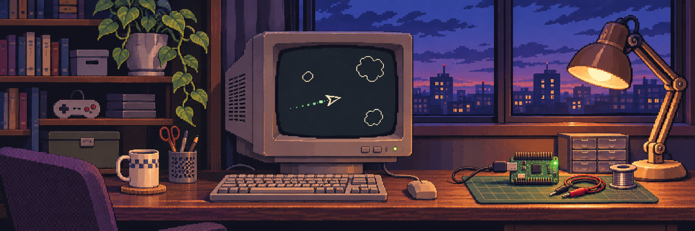

**日本語** · [English](README.en.md)

# Anatolii Ponomarev

Unityでゲームを作っています。ゲームの仕組みをじっくり掘り下げて、どう動いているのかを理解するのが好きです。  
これからは、マイコンを使ったものづくりにも挑戦したいです。

**ゲーム開発**

**これから学びたい組み込み開発**

 

## 作業中の音楽

  
  

## GitHubでの活動

<picture>
  <source media="(prefers-color-scheme: dark)" srcset="https://raw.githubusercontent.com/anatolii-ponomarev/anatolii-ponomarev/master/assets/pacman-contribution-graph-dark.svg">
  <source media="(prefers-color-scheme: light)" srcset="https://raw.githubusercontent.com/anatolii-ponomarev/anatolii-ponomarev/master/assets/pacman-contribution-graph.svg">
  
</picture>
